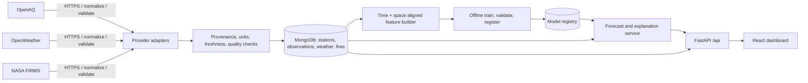

# AirSense AI — production architecture

**Scope.** SIH26082, an air pollution and weather coupled forecasting system. This design uses OpenAQ observations, OpenWeather weather, and NASA FIRMS fire detections as its only external data providers. The browser calls AirSense APIs only. No synthetic observations, demo values, or fabricated fallbacks are permitted. Missing, stale, or unavailable data is represented as unavailable with source and freshness metadata.

## System boundaries and folder structure

```text
.
├── ARCHITECTURE.md
├── README.md
├── .env.example
├── backend/
│   ├── requirements.txt
│   └── app/
│       ├── main.py                 # lifespan, middleware, routes
│       ├── config.py               # validated settings and source policy
│       ├── database.py             # Motor lifecycle, indexes
│       ├── logging_config.py       # structured application logs
│       ├── errors.py               # typed errors and HTTP handlers
│       ├── models/                  # persisted Mongo document models
│       ├── schemas.py              # public request/response contracts
│       ├── api/router.py            # versioned API composition
│       ├── routes/                  # air quality, weather, FIRMS, forecasts, etc.
│       └── services/                # provider adapters, normalization,
│                                    # persistence, forecasting, risk, XAI
└── frontend/
    ├── package.json
    ├── vite.config.ts
    ├── tsconfig.json
    ├── index.html
    └── src/
        ├── main.tsx, App.tsx, index.css
        ├── api/                     # typed HTTP client and query hooks
        ├── components/              # shared states, charts, maps, shell
        ├── pages/                   # ten requested pages
        ├── state/                   # URL filters and small UI state
        └── types/                   # API contracts
```

## Deployment and trust boundaries

React/Vite static assets are served behind a TLS reverse proxy. `/api` routes to stateless FastAPI workers; workers access MongoDB through a private network and make outbound HTTPS requests only to the three approved providers. Secrets remain in a deployment secret manager/environment, never in Vite variables or client bundles. Configure per-provider timeouts, bounded retries with jitter for idempotent reads, rate limits, and circuit breakers. Run periodic ingestion as a separate scheduled worker using the same service layer; API requests may also refresh-on-demand behind a per-location/provider lock. Do not let a provider failure trigger fabricated or stale-as-current results.

## MongoDB schema

Collections use BSON ObjectId `_id`, UTC `observed_at`/`fetched_at`, schema version, and source provenance. Geospatial coordinates are GeoJSON Point `[longitude, latitude]` (2dsphere index); all units are explicit.

| Collection | Core fields | Indexes / retention |
|---|---|---|
| `stations` | provider station ID, name, location, state/district, coordinates, pollutants/capabilities, active | unique `(provider, station_id)`, 2dsphere |
| `observations` | station ref, observed_at, pollutant measurements (value/unit/averaging period), source, fetched_at, quality flags | unique `(source, station_id, pollutant, observed_at)`, `(location, observed_at)`, TTL per approved retention policy |
| `weather_observations` | location, observed_at, temperature, humidity, pressure, wind, precipitation, cloud, provider, fetched_at | `(location, observed_at desc)`, 2dsphere |
| `fire_hotspots` | FIRMS source ID, location, acquisition time, confidence, FRP, satellite/instrument, day/night, source, fetched_at | unique `(source, source_id)`, 2dsphere, `(acquired_at desc)` |
| `forecasts` | location/grid cell, issued_at, horizon, target_at, pollutant, predicted value/unit, model/version, feature window, uncertainty, training-data cutoff, provenance, explanation ref | unique `(cell, model_version, target_at, pollutant)`; TTL by policy |
| `model_registry` | model/version, artifact URI/checksum, training interval, features, metrics, approval status, created_at | unique `(name, version)` |
| `audit_events` | actor/service, action, resource, time, request ID, policy/result | `(time desc)`, immutable export/retention policy |

Only store provider-licensed data for the provider's permitted duration. TTLs are deployment policy values, not silent assumptions. Index setup is idempotent at startup/migration time. Raw provider payloads are excluded by default; if audit retention requires them, redact credentials and apply access controls and provider terms.

## API architecture

All data endpoints are under `/api`, JSON, UTC ISO-8601, consistent error envelope `{error:{code,message,request_id,retryable}}`; validation errors include field paths. OpenAPI is generated from Pydantic schemas. Health/liveness is separate from dependency readiness. Location requests validate latitude/longitude, bounded radius, time window, and requested horizon. Provider failures return a source-specific unavailable state (HTTP 503 when no usable result); partial multi-source responses carry per-source status. Never convert an error into a numeric zero.

| Route | Contract and behavior |
|---|---|
| `GET /weather?lat=&lon=` | OpenWeather current conditions, timestamp, units, provider status/freshness |
| `GET /air-quality?lat=&lon=&place_name=` | OpenAQ current pollutant readings from nearby stations, station distance and timestamps; AQI is left unavailable when the source does not supply it |
| `GET /air-quality/history?lat=&lon=&days=` | OpenAQ historical measurements for pollutant sensors at the nearest available station, bounded to 1–90 days |
| `GET /fire-hotspots?bbox=&since=` | NASA FIRMS detections clipped to bounded area/time; include acquisition time, confidence, FRP and satellite |
| `GET /forecast?lat=&lon=&hours=` | Forecast values, intervals, model/version, training cutoff, feature provenance and explanation; unavailable until evidence-qualified model exists |
| `GET /inversion?lat=&lon=` | Weather-linked inversion *indicator* with evidence, thresholds/version and uncertainty; report unavailable where required inputs are missing; no unsupported claim of measured inversion |
| `GET /health-risk?lat=&lon=&group=` | General guidance remains unavailable until validated exposure thresholds and source-backed rules are configured |
| `GET /recommendations?lat=&lon=` | Evidence-grounded actions tied to observed/forecast conditions; include rationale and source timestamps |
| `GET /health/live`, `GET /health/ready` | process liveness and Mongo/provider readiness respectively; never expose secrets |

Pagination and response size limits apply to hotspot and station results. Provider adapters isolate provider-specific schemas and credentials. Cache only with explicit TTL and include `fetched_at`/staleness; provider outage is not hidden by cache.

## Data flow



```mermaid
sequenceDiagram
  participant UI as React client
  participant API as FastAPI
  participant S as Domain service
  participant P as OpenAQ / OpenWeather / NASA
  UI->>API: GET /api/air-quality?lat&lon
  API->>S: validated request + request ID
  S->>P: provider request (timeout, bounded retry)
  P-->>S: provider response or explicit failure
  S->>S: validate, normalize, provenance/freshness
  S-->>API: normalized observations with source timestamps or typed unavailable
  API-->>UI: typed JSON + status; no invented values
```

## ML and hyperlocal forecasting

Forecasting is a gated capability, not an assumed result. Build a time/space-aligned dataset from real OpenAQ pollutant observations, OpenWeather covariates, and optionally NASA FIRMS fire features. Preserve station coverage gaps and source freshness; never impute a missing target into a truth label. Start with persistence and seasonal baselines, then compare a regularized tree/boosting model and a spatiotemporal model only when data volume supports it. Use rolling-origin temporal validation, station-held-out geographic validation, leakage checks, and per-pollutant MAE/RMSE plus calibrated interval coverage. Record metrics and training cutoff; only promote a model after predeclared acceptance thresholds and human review. If no approved model or adequate features exist, `/forecast` returns unavailable.

Hyperlocal prediction partitions geography into a configured grid/geohash. Candidate inputs are nearby OpenAQ stations with distance and age decay, local OpenWeather conditions, time/calendar features, and FIRMS hotspots with distance/acquisition recency. The feature builder records which inputs were actually present. Restrict interpolation/extrapolation to a validated coverage radius; estimate uncertainty from spatial support and temporal freshness. Return cell resolution, nearest station distances, contributing sources, coverage warning, interval, and model version. Do not label station-level observations as a neighborhood measurement.

## Explainable AI and inversion

For every prediction retain feature names/values, source record IDs and timestamps, model/version, training cutoff, and interval. Provide model-appropriate global importance and per-request local attribution (e.g. SHAP for supported tree models), with a warning that attribution describes model contribution, not causality. The UI exposes evidence, freshness, coverage, uncertainty, and attribution together. For inversion, the service may compute a transparent meteorological indicator from available temperature/pressure/wind observations only when the validated formula's required inputs are present. Distinguish indicator from direct vertical-profile measurement; surface weather alone cannot prove an inversion. Version thresholds and show inputs.

## Frontend, state, and unavailable behavior

Ten React routes: Dashboard, Map, Forecast, Hyperlocal, Fire Intelligence, Explainable AI, Health Risk, Government Dashboard, Analytics, Reports. Shared shell, typed API client, React Query hooks, Leaflet maps, Recharts plots, and Framer Motion transitions. URL query parameters own shareable location/time/filter state; React Query owns server state/cache/invalidation; local component state owns transient interactions. Do not duplicate API data in global state. Every query uses loading, empty, error, and stale states. For unavailable/failed APIs show the exact text **“Data Currently Unavailable”**, source/reason when safe, and retry; never draw fake series, map markers, KPIs, or numeric defaults. Government views require authenticated roles and audit logging in production; the initial UI must not imply an authorization system exists unless configured.

## Security, observability, and operations

TLS, strict CORS allowlist, request IDs, input bounds, rate limits, secret redaction, least-privilege MongoDB users, and role-based access for government functions. Logs are structured JSON and contain latency, route, request ID, provider outcome, and model version, without keys or sensitive personal data. Metrics cover provider success/latency/freshness, ingestion lag, database health, forecast availability/error/quality, and API latency. Alerts cover stale source feeds, failed index/migration, provider outage, and model drift. Readiness checks Mongo; liveness does not. Backups, restore drills, schema migrations, model rollback, and retention policies are deployment requirements.

## Delivery sequence

1. Configure secrets, provider access, MongoDB, retention and deployment network policy.
2. Ship provider adapters, provenance schemas, health checks and data freshness dashboards.
3. Validate coverage and licensing; operate ingestion and measure data quality.
4. Train/evaluate models with temporal and geographic holdouts; register only approved models.
5. Enable forecasts, explainability, risk guidance and government roles after evidence/security review.
6. Release the UI with truthful unavailable states until each API capability is live.
